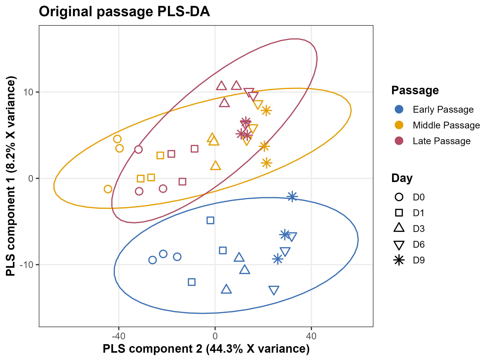

# C2C12 lipidomics analysis for CoQ

[Complete workflow and interpretation](20260905_Final_Analysis/README.md)

[Code availability (00-08)](20260905_Final_Analysis/Code%20availability)
| [Working scripts](20260905_Final_Analysis/RStudio)
| [Methods](20260905_Final_Analysis/docs/MULTIVARIATE_METHODS.md)

The requested original passage-supervised PLS-DA view is generated by
[Code 06](20260905_Final_Analysis/Code%20availability/06_original_passage_PLSDA.R):
horizontal = negative original component 2 (44.3% X variance);
vertical = original component 1 (8.2%). Labels retain the PLS component identities.

The separately named Day-target PLS-DA is reproduced by Code 05.
Ordinary PCA and optional exploratory PCA/ASCA views remain distinct.

The raw normalized-abundance input is private and excluded. Place it at
Lipidomics_normalized_abundance_positive.csv in the repository root to run the
input-dependent analyses. Run 00_run_all.R from either script directory.
RStudio and Code availability contain identical scripts.

[Validation record](20260905_Final_Analysis/docs/SYNC_VALIDATION_20261102.md)
